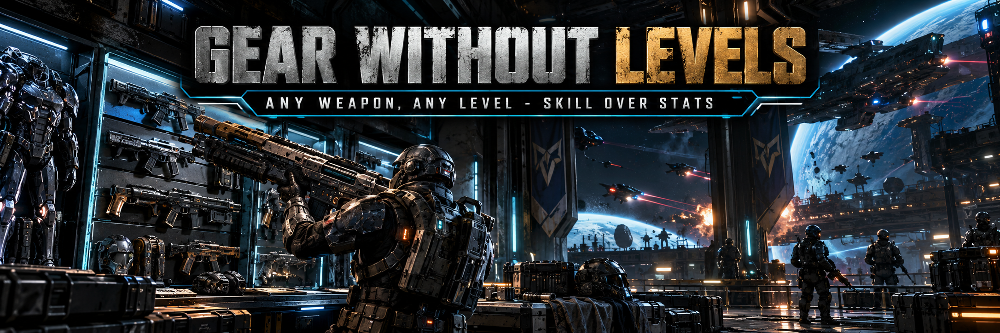

# Gear Without Levels — for SpaceBourne 2

In SpaceBourne 2 a weapon or suit above your character level cannot be equipped ("High
Level"). That is an MMO rule: a better rifle does not need a level. What a rookie lacks is
familiarity with advanced kit.

**Gear Without Levels** removes the level lock for weapons, melee weapons and suits. Kit
above your level always works, but handles a little worse until you have the experience for it:

- firearms kick a bit more per shot (up to +40 %);
- melee weapons cost a bit more stamina per swing (up to +25 %);
- an advanced suit tires you a bit faster when sprinting or swinging (up to +20 %).

The penalty depends on how far above you the item is, on a log scale: an item at twice your
level gives about half of it, the ±2 levels of normal loot give almost nothing, and a veteran
adapts faster than a rookie. **Training** helps too: rounds fired with a gun, swings with a
blade and exertion in a suit make you familiar with that item and remove up to three quarters
of its penalty before you level up. Damage, protection and rate of fire are **never** changed.

The mod changes no items and nothing in your saves. Gear you equipped with it stays equipped
if you remove it later.

## Install

Needs **UE4SS**, a free script loader for Unreal Engine games. If you already play with
[Hardcore Tactical Realism](https://github.com/hubertdungen/SpaceBourne2-HardcoreTacticalRealism)
or SB2 HOTAS, you have it.

1. Download `GearWithoutLevels-x.y.z.zip` from
   [Releases](https://github.com/hubertdungen/SpaceBourne2-GearWithoutLevels/releases/latest)
   or [Nexus Mods](https://www.nexusmods.com/spacebourne2/mods/7).
2. Open your game folder (`...\SpaceBourne 2`, the one with `SpaceBourne2.exe`) and extract
   the zip **there**. It creates `SB2\Binaries\Win64\Mods\GearWithoutLevels` and switches
   itself on (`enabled.txt`).
3. No UE4SS yet? Get [RE-UE4SS 3.0.1](https://github.com/UE4SS-RE/RE-UE4SS/releases/tag/v3.0.1)
   and copy `dwmapi.dll`, `UE4SS.dll` and `UE4SS-settings.ini` into
   `SpaceBourne 2\SB2\Binaries\Win64\`.

**Uninstall:** delete the `GearWithoutLevels` folder.

## Controls

- **Shift+Delete** switches the mod on/off in game (remembered between sessions). The mod is
  **off** until you switch it on (or set `Enabled = true` in `scripts/config.lua`).
- A short message on screen confirms the switch and tells you when you equip unfamiliar kit.

## Settings (`scripts/config.lua`)

- `Penalty` — strength per kit type (recoil, melee stamina, suit stamina) and how fast the
  penalty grows with the level gap.
- `Training` — rounds, swings and stamina bars for full familiarity; how much training can
  remove (default 75 %).
- `Unlock.PickLists` — show over-level items in the character screen's item picker.
- `Unlock.ShopShowsAllLevels` — make the shop's "show unusable" filter treat every item as usable.
- `Standalone.DamageCapLevels` — used only without Hardcore Tactical Realism (below).

## With Hardcore Tactical Realism

Built as a companion to **Hardcore Tactical Realism (HTR)**, where damage depends on calibre,
armor and hit zone instead of item level. With HTR's optional gear bonus (F8) on, an over-level
weapon still gives its small HTR bonus (up to +8 penetration, +15 % damage at level 60), so the
result is a **minor bonus with a small handling cost**.

Without HTR, vanilla weapon damage grows a lot with item level (×3.7 from level 10 to 40), so
this mod caps an over-level gun to the damage of a gun 5 levels above you. It never becomes an
exploit.

## Part of the SpaceBourne 2 realism set

This mod is part of the realism set, built around [Hardcore Tactical Realism](https://www.nexusmods.com/spacebourne2/mods/4) as the core mod. HTR is not required: this mod works on its own or with any of the others. **Install them all at once** with the [SpaceBourne 2 Realism installer](https://www.nexusmods.com/spacebourne2/mods/11) ([GitHub](https://github.com/hubertdungen/SpaceBourne2-Realism)): tick the mods you want, and it switches them on and keeps them up to date.

- **Hardcore Tactical Realism (HTR)**: the core: realistic ballistics, wounds and tactical AI. [GitHub](https://github.com/hubertdungen/SpaceBourne2-HardcoreTacticalRealism) · [Nexus](https://www.nexusmods.com/spacebourne2/mods/4) · [Steam](https://steamcommunity.com/app/1646850/discussions/0/573805072991123580/)
- **Split Controls**: separate look inversion for ships and on foot. [GitHub](https://github.com/hubertdungen/SpaceBourne2-SplitControls) · [Nexus](https://www.nexusmods.com/spacebourne2/mods/5)
- **Silent Ops**: realistic stealth, suppressors and silent takedowns. [GitHub](https://github.com/hubertdungen/SpaceBourne2-SilentOps) · [Nexus](https://www.nexusmods.com/spacebourne2/mods/6)
- **Gear Without Levels** *(this mod)*: any weapon or suit at any level, with small penalties. [GitHub](https://github.com/hubertdungen/SpaceBourne2-GearWithoutLevels) · [Nexus](https://www.nexusmods.com/spacebourne2/mods/7)
- **SB2 HOTAS**: joystick, HOTAS, pedals, head tracking and triple screen. [GitHub](https://github.com/hubertdungen/SpaceBourne2-HOTAS) · [Nexus](https://www.nexusmods.com/spacebourne2/mods/8)
- **Faction Power**: dungeons, sales and missions earn your faction power. [GitHub](https://github.com/hubertdungen/SpaceBourne2-FactionPower) · [Nexus](https://www.nexusmods.com/spacebourne2/mods/9)
- **Tactical Engineering**: deployable turrets and barricades that take time to set up. [GitHub](https://github.com/hubertdungen/SpaceBourne2-TacticalEngineering) · [Nexus](https://www.nexusmods.com/spacebourne2/mods/10)
- **Ammo Discipline**: realistic ammo limits and scavenging. [GitHub](https://github.com/hubertdungen/SpaceBourne2-AmmoDiscipline) · [Nexus](https://www.nexusmods.com/spacebourne2/mods/12)
- **Ground Waypoints**: planet waypoints on foot and on the hoverbike. [GitHub](https://github.com/hubertdungen/SpaceBourne2-GroundWaypoints) · [Nexus](https://www.nexusmods.com/spacebourne2/mods/13)

Coming soon: Tactical First Person, Get Out of the Way.

<!-- nexus:skip -->
## For modders

- `scripts/gal/gamedefs.lua` holds every game-internal name; after a game update, that is the
  only file to check.
- `docs/DESIGN.md` explains where the game enforces the level lock and how the mod works.
<!-- /nexus:skip -->

## License

MIT licensed — see `LICENSE`. Uses [UE4SS](https://github.com/UE4SS-RE/RE-UE4SS) (MIT).
